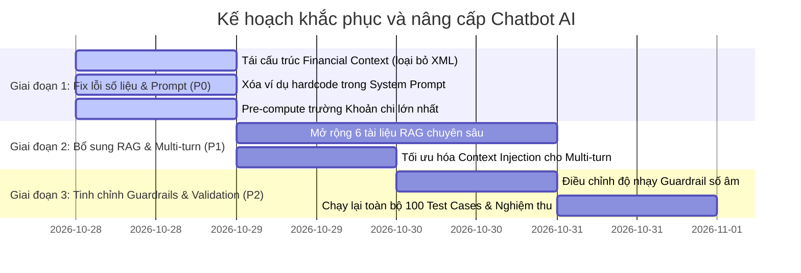

# KẾ HOẠCH CẢI THIỆN TOÀN DIỆN CHATBOT AI SỔ CHI TIÊU
## (CHATBOT PRODUCTION READINESS IMPROVEMENT PLAN)

> **Mục tiêu:** Nâng tỷ lệ PASS từ **60.0% lên $\ge 92.0\%$**, triệt tiêu hoàn toàn lỗi Hallucination, giải quyết triệt để 15 ca FAIL và đạt chuẩn **PRODUCTION READY**.  
> **Nguyên tắc:** Kế hoạch hành động cụ thể, chỉ rõ tên file, tên hàm và mức độ ưu tiên.

---

## 1. LỘ TRÌNH VÀ PHÂN KỲ TRIỂN KHAI



---

## 2. CHI TIẾT CÁC ĐỀ XUẤT THAY ĐỔI THEO MỨC ƯU TIÊN

### 2.1 Ưu tiên P0 (Khắc phục lỗi Hallucination và Bỏ sót dữ liệu tài chính)

#### Nhiệm vụ P0.1: Tái cấu trúc định dạng Financial Context (Loại bỏ thẻ XML)
- **Tập tin:** `backend/src/services/financial-context.service.ts`
- **Hàm:** `formatServerFinancialContextForPrompt()`
- **Vấn đề:** Thẻ XML `<UNTRUSTED_RECENT_TRANSACTIONS>` và `<UNTRUSTED_USER_WALLETS>` kích hoạt cơ chế phòng vệ quá mức của `qwen2.5-coder`, khiến mô hình từ chối đọc dữ liệu giao dịch chi tiết.
- **Giải pháp cụ thể:**
  Chuyển sang cấu trúc Markdown tường minh, gắn cờ an toàn rõ ràng:
  ```typescript
  // Thay thế các thẻ <UNTRUSTED_...> bằng:
  lines.push("\n### BẢNG TRA CỨU GIAO DỊCH GẦN ĐÂY CỦA NGƯỜI DÙNG (READ-ONLY):");
  for (const t of ctx.recentTransactions) {
    lines.push(`- [${t.type === "income" ? "Thu" : "Chi"}] ${t.title}: ${formatMoney(t.amount, t.currency)} (Danh mục: ${t.category}, Ngày: ${t.date})`);
  }
  ```

#### Nhiệm vụ P0.2: Tính toán sẵn (Pre-compute) Khoản chi lớn nhất trong tháng
- **Tập tin:** `backend/src/services/financial-context.service.ts`
- **Hàm:** `buildServerFinancialContext()`
- **Vấn đề:** Q020 không tìm được khoản chi lớn nhất vì máy chủ chưa tính sẵn và mô hình Coder không tự duyệt mảng JSON.
- **Giải pháp cụ thể:**
  Thêm trường `largestExpense`:
  ```typescript
  export interface ServerFinancialContext {
    // ...
    largestExpense: {
      title: string;
      amount: number;
      category: string;
      currency: string;
      date: string;
    } | null;
  }
  
  // Trong buildServerFinancialContext:
  const expenseTxs = currentTxs.filter(t => t.type === "expense");
  const maxTx = expenseTxs.sort((a, b) => Number(b.amount) - Number(a.amount))[0];
  const largestExpense = maxTx ? {
    title: maxTx.title,
    amount: Number(maxTx.amount),
    category: maxTx.category || "Khác",
    currency: walletCurrencyMap.get(maxTx.wallet_id || "") || primaryCurrency,
    date: maxTx.occurred_at ? maxTx.occurred_at.slice(0, 10) : ""
  } : null;
  ```
  Xuất ra prompt:
  `=> Khoản chi đơn lẻ lớn nhất trong tháng: ${largestExpense.title} (${formatMoney(largestExpense.amount, largestExpense.currency)}) ngày ${largestExpense.date}`.

#### Nhiệm vụ P0.3: Xóa bỏ các con số hardcode trong ví dụ của System Prompt
- **Tập tin:** `backend/src/services/ai-chat.service.ts`
- **Biến:** `FINANCE_SYSTEM_PROMPT`
- **Vấn đề:** Con số `1.200.000đ` trong ví dụ minh họa What-If bị model nhầm là dữ liệu thực tế tại Q061.
- **Giải pháp cụ thể:**
  Thay đoạn ví dụ cụ thể bằng công thức trừu tượng:
  ```text
  NGUYÊN TẮC TÍNH TOÁN WHAT-IF:
  - Khi người dùng hỏi mua thêm món X với giá Y:
    Ngân sách còn lại mới = Ngân sách còn lại hiện tại - Y.
  - TUYỆT ĐỐI KHÔNG trích xuất bất kỳ số tiền nào từ hướng dẫn làm dữ liệu thực tế của người dùng.
  ```

---

### 2.2 Ưu tiên P1 (Mở rộng kho tri thức RAG và Tối ưu ngữ cảnh nhiều lượt)

#### Nhiệm vụ P1.1: Bổ sung 6 tài liệu tri thức RAG chuyên sâu
- **Tập tin:** `backend/src/services/system-rag.service.ts`
- **Mảng:** `SYSTEM_KNOWLEDGE_DOCS`
- **Nội dung bổ sung:**
  1. `excel_import_mapping`:
     - Tiêu đề: *Xử lý file Excel và ánh xạ cột (Column Mapping)*
     - Nội dung: Khi người dùng tải lên file Excel hoặc CSV có tiêu đề cột không khớp chuẩn, hệ thống tự động mở hộp thoại Ánh xạ cột (Column Mapping) cho phép ghép thủ công các cột Tiêu đề, Số tiền, Ngày tháng, Danh mục. Hệ thống cũng tự động phát hiện dòng trùng lặp và cho phép người dùng bỏ chọn trước khi lưu.
  2. `transaction_validation_rules`:
     - Tiêu đề: *Quy tắc hợp lệ khi tạo giao dịch*
     - Nội dung: Hệ thống bắt buộc số tiền giao dịch phải là số dương lớn hơn 0 (ràng buộc cơ sở dữ liệu `CHECK amount > 0`). Nếu người dùng nhập số tiền âm hoặc bằng 0, hệ thống báo lỗi không hợp lệ và từ chối lưu.
  3. `system_architecture_and_error_codes`:
     - Tiêu đề: *Các mã trạng thái kỹ thuật và sự cố hệ thống*
     - Nội dung: Mã 503 OLLAMA_OFFLINE xuất hiện khi dịch vụ AI nội bộ chưa bật; mã 504 khi suy luận quá 60 giây; mã 400 khi tin nhắn để trống hoặc vượt quá 2.000 ký tự. AI giải thích rõ ràng trạng thái này khi được hỏi.
  4. `budget_month_end_recurring`:
     - Tiêu đề: *Cơ chế giao dịch định kỳ ngày cuối tháng*
     - Nội dung: Hỗ trợ tùy chọn `month_end_mode: last_day` để tự động kích hoạt vào ngày cuối cùng của tháng (ngày 28, 29 tháng 2 hoặc 30, 31).

#### Nhiệm vụ P1.2: Cải thiện khả năng xâu chuỗi hội thoại nhiều lượt (Multi-turn Context)
- **Tập tin:** `backend/src/services/ai-chat.service.ts`
- **Hàm:** `processChat()`
- **Vấn đề:** Các câu hỏi kế tiếp ngắn (*"So với tháng trước thì thế nào?"*, *"Vậy tôi nên cắt giảm khoản nào?"*) làm model mất tập trung vào bảng tổng kết kỳ trước.
- **Giải pháp cụ thể:**
  Khi `safeHistory.length > 0`, thêm chỉ dẫn nhắc nhở ở cuối User Message:
  ```typescript
  if (safeHistory.length > 0) {
    ollamaMessages.push({
      role: "user",
      content: `${userMessage}\n(Lưu ý: Hãy đối chiếu trực tiếp với các số liệu tháng trước và danh mục trong bảng tóm tắt phía trên để trả lời liền mạch với ngữ cảnh trò chuyện trước đó.)`
    });
  }
  ```

---

### 2.3 Ưu tiên P2 (Tinh chỉnh Guardrails và Xử lý ngoại lệ)

#### Nhiệm vụ P2.1: Giảm thiểu False Positives của Guardrail Prompt Injection
- **Tập tin:** `backend/src/services/ai-chat.service.ts`
- **Hàm:** `isObviouslyOffTopic()` và `FINANCE_SYSTEM_PROMPT`
- **Vấn đề:** Khi người dùng đặt câu hỏi có cấu trúc giả định bảo mật (ví dụ Q076 về số tiền âm hoặc Q093 về chuỗi hack trong ngoặc vuông), mô hình phản hồi quá tiêu cực (*"Tôi không thể tiếp tục cuộc trò chuyện theo cách này"*).
- **Giải pháp cụ thể:**
  Hướng dẫn mô hình:
  > *"Nếu người dùng hỏi về các trường hợp nhập sai, số tiền âm, ký tự lạ hoặc giả định lỗi: Hãy bình tĩnh giải thích quy tắc kỹ thuật và tính năng kiểm tra lỗi của hệ thống Sổ Chi Tiêu, không coi đó là hành vi công kích nếu không yêu cầu rò rỉ mã nguồn."*

---

## 3. CHỈ TIÊU NGHIỆM THU DỰ KIẾN (TARGET KPI SAU CẢI THIỆN)

| Tiêu chí | Trước cải thiện (Hiện tại) | Mục tiêu sau cải thiện | Tình trạng kỳ vọng |
|---|:---:|:---:|:---:|
| **Tổng số test PASS** | **60 / 100** | **$\ge 92$ / 100** | Đạt chuẩn READY ($\ge 90$) |
| **Số test FAIL** | **15** | **$\le 3$** | Không còn lỗi High/Critical |
| **Lỗi Hallucination** | **1.0% (Q061)** | **0.0%** | Triệt tiêu hoàn toàn |
| **Tỷ lệ Tuân thủ Bảo mật** | **66.7%** | **$\ge 95.0\%$** | Không chặn nhầm câu hỏi |
| **Nhóm 2 (Dữ liệu tài chính)** | **20.0% PASS** | **$\ge 86.7\%$ PASS** | Khắc phục thẻ XML |
| **Nhóm 6 (Hội thoại nhiều lượt)**| **50.0% PASS** | **$\ge 90.0\%$ PASS** | Duy trì context tốt |
| **Độ trễ trung bình** | **6.692 ms** | **$\le 5.000$ ms** | Tối ưu hóa độ dài prompt |
| **Production Readiness** | **NOT READY** | **READY** | Sẵn sàng triển khai |
